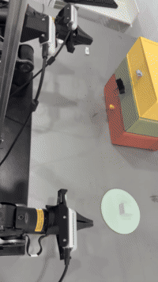

# piper-dual-arm-drawer-task（π0 双 Piper 抽屉任务）

双 Piper 机械臂的**抽屉任务**：机器人自己拉开抽屉 → 把蓝方块放进抽屉 → 合上抽屉 → 自动归位。



真机实拍（24 s）：这一段录的是前半程 —— 抽屉被拉开、方块臂从绿色圆盘上取起蓝方块往抽屉送；
整段 51.7 s 的完整流程见 `full/`。

任务是靠一份 **π0 策略**做的：2026-10-14 在 A10 上用 today99 数据集微调、训到 20,000 步，
权重已同步到 3090；它的部署链路与整段任务都已在**真机**上跑通（见第三节）。

本仓是这条策略的**部署侧全套**：

- **客户端**（`shared/`）：闸门、速率限速、跟踪校验、使能前位姿闸门、归位、报告、trace —— 真机跑 π0 策略时用的就是它，逻辑一字未改。
- **三段动作序列**（`full/` / `pull/` / `cubephase/`）：把整个任务拆成三段，逐拍发给机器，每段都能单独起、单独跑（`full/` 已在真机整段跑通）。

本仓**不带**模型权重、数据集与归一化统计（权重在 3090 的推理根下，见 `NOTICE`）。
三段连的是"按序列回答"的本地服务，好让策略服务不在场、也不方便反复起它的时候，
把动作与实际时序单独验干净；把 `--url` 换成 3090 上的 π0 策略服务，
**同一份客户端跑的就是策略本身** —— 两者共用同一套闸门、限速与跟踪校验。

## 一、π0 策略（2026-10-14，A10 上训）

| 项 | 值 |
|---|---|
| 基座 | **π0**（openpi，`pi05=False`），LoRA 微调 |
| LoRA 部位 | `paligemma_variant=gemma_2b_lora` ＋ `action_expert_variant=gemma_300m_lora` |
| 数据 | today99 —— 训练 **86 集 / 69,078 帧**，留出验证 **13 集 / 10,628 帧**；30 fps；`robot_type=piper_dual` |
| 观测 | 三路相机 `observation.images.top_head` / `hand_left` / `hand_right`（480×640×3）＋ 14 维 `observation.state` |
| 动作 | 14 维（左 J1–J6＋爪、右 J1–J6＋爪），**绝对关节目标**（`use_delta_joint_actions=False`） |
| 动作头 | `action_horizon=10`，`action_dim=32`（14 维真实动作 pad 到 32） |
| 归一化 | 只算训练集统计（`norm_stats.json`），随权重复用 |
| 训练 | A10，`batch=8`、2 个 dataloader worker、XLA 显存比例 0.95；**10,000 步 → 续训到 20,000 步** |
| 检查点 | `checkpoints/drawer_today99_v1/drawer_today99_pi0_lora_10k_20261014`，末检查点 **19999** |
| 两段耗时 | 各约 6 h 50 min（26.1 s/it → 21.8 s/it）；OOM 0 次、Traceback 0 次，跑完打印 `PI0_TODAY99_TRAINING_COMPLETED` |
| 权重落在哪 | 同步到 3090 `/home/databall/pi0_today99_20261015/19999`（带 `norm_stats.json`） |

**本仓不含**权重、数据集、归一化统计 —— 见 `NOTICE`。

## 二、三段动作序列

三段都是这份任务的一部分（源：today99 / `episode_000041`「机器人自己把抽屉拉开 -
把蓝方块放进抽屉 - 再把抽屉合上」），经**协调时间重参数化**后逐拍发给机器，
14 个轴永远处在同一条参照时刻。

| 目录 | 一整套任务里的哪一段 | 长度（拉伸前 → 后） | 干什么 | 跑到哪一步 |
|---|---|---|---|---|
| `full/` | 完整任务 | 703 → **1551 拍 / 51.7 s**（2.21×） | 抽抽屉 → 放方块 → 合抽屉 → **自动归位** | **真机整段跑通**（见第三节） |
| `pull/` | 前段 | 253 → **545 拍 / 18.2 s**（2.15×） | 只做"伸手 → 咬住拉环 → 拉开约 11 cm → 松手" | 离线自测全过；**真机未跑** |
| `cubephase/` | 中段 | 440 → **751 拍 / 25.0 s**（1.71×） | 抽屉臂**钉在起跑位姿不动**，只让方块臂夹住蓝方块放进抽屉 | 离线自测全过；**真机未跑** |

只有 `full/` 的第 4 段"自动归位"是补出来的（演示里机器人没回家）；其余每一拍都在语料里。
`full/` 的归位段是第 1310–1521 拍，末行逐位等于复位目标 —— 跑完就坐在起跑位姿上，可以原地再跑。

## 三、真机验证结果

| 时间 | 哪一段 | 实测 |
|---|---|---|
| 2026-10-16 11:01:17 | `full/` 整段 | **174 块 / 1738 拍**；复位误差 **0.0015 rad**；跟踪误差 **0.0236 rad**；抽屉爪咬住 **0.0089 m**；抽屉臂拉到 **1.4986**（演示 **1.5014**）；末态离起跑位姿 **0.0010** ＝ 自动归位走到了；闸门 0 拒绝、无 Safety stop、跑完两臂仍使能 |
| 2026-10-16 11:41:09 / 11:42:33 | `full/` 整段 | 各 **1739 拍**，同样跑完整段 |
| 2026-10-15 18:51 | `full/` 整段 | 1739 拍；复位 **0.0032 rad**；跟踪 **0.0234 rad**；末态离起跑位姿 **0.0017 / 0.0023** ＝ 自动归位走到了 |
| 2026-10-14 | π0 策略本身（`--url` 指策略服务） | 两条臂都按策略朝任务动、闸门 **0 拒绝**、硬件链路全通 |

`full/` 的整段测试是把**这整套任务**做在真机上：拉抽屉 → 把蓝方块放进抽屉 → 合上抽屉 →
自动回起跑位姿，两条臂都按计划动完，机器停在起跑位姿上、可原地再跑。

按段如实分层：**只有 `full/` 在真机上整段跑过**；`pull/` 与 `cubephase/` 目前只有
离线自测与干跑，**真机还没跑** —— 干跑报告里逐字是 `result = dryrun_passed_no_commands`
（`SDK was not initialized`，一行命令没发、电机没使能）。

还有一条要说清楚：**客户端自己不下成败判决**。真机跑完的报告里 `result` 逐字是
`bounded_trial_finished_task_outcome_unverified` —— 它的结论只是"动作在闸门与限速内
发完了"，任务成不成要人看现场（上表那几行"末态离起跑位姿 0.0010""抽屉爪咬住 0.0089 m"
就是用来判这个的实测）。

## 四、目录

| 路径 | 是什么 |
|---|---|
| `full/` | 完整任务那一段（唯一有 `check` / `cam` / `pose` 三种无真机闸门的一段） |
| `pull/` | 拉抽屉单测 |
| `cubephase/` | 放方块单测 |
| `shared/` | 三段的公共件：客户端、控制模块、链路自检、驱动封装、复位目标 |
| `config/env.sh.example` | 机器相关路径的对照表（备忘，不被 source） |
| `assets/drawer_task.gif` | 上面那张真机实拍动图（24 s，200×356） |
| `LIVE.md5` | `shared/` 那 6 件与机器上活文件的 md5 对照 |
| `ARTIFACTS.md5` | 全包指纹；每段自己那份在段目录里，跑起来第 `[0/5]` 步会核 |

`shared/` 里的 6 件：客户端 `pi0_real_trial_v8.py`、控制模块 `pi0_rollout_v8.py`、
链路自检 `check_pi0_link_v8.py`、驱动封装 `verified_hardware.py`、
相机帧落盘 `pi0_frame_snapshots.py`、抽屉臂复位的公共目标 `home_target_cubephase.json`。

其中客户端就是真机跑 π0 策略的那一份（逻辑一字未改，只把名字前缀换成了 `pi0_`）：
它按 HTTP 向"策略服务"要动作。**把服务端换成 π0 策略服务，跑的就是策略本身；
三段自带的本地服务端按序列回答，跑的就是同一串动作。** 两者共用同一套闸门与限速。

## 五、怎么跑

三段都能从任意目录直接敲（启动器自己算自己的位置，不需要 `cd`）：

```bash
bash /home/databall/pi0_infer_3090/full/run_full.sh  check      # 仅 full 有
bash /home/databall/pi0_infer_3090/full/run_full.sh  cam        # 仅 full 有
bash /home/databall/pi0_infer_3090/full/run_full.sh  pose       # 仅 full 有
bash /home/databall/pi0_infer_3090/full/run_full.sh  dry-run
bash /home/databall/pi0_infer_3090/full/run_full.sh  motion

bash /home/databall/pi0_infer_3090/pull/run_pull.sh        dry-run
bash /home/databall/pi0_infer_3090/pull/run_pull.sh        motion

bash /home/databall/pi0_infer_3090/cubephase/run_replay.sh dry-run
bash /home/databall/pi0_infer_3090/cubephase/run_replay.sh motion
```

`[seconds|auto]` 是第二个参数：动作窗口长度，默认 `auto`（从轨迹 meta 算出来，多留 6 s）。

| 模式 | 碰相机 | 碰 CAN | 发指令 | 抓什么 |
|---|---|---|---|---|
| `check` | 不碰 | 不碰 | 不 | 产物指纹、轨迹与旋钮对得上、服务能起、链路自检 |
| `cam` | 只读 TCP 流几帧 | 不碰 | 不 | 相机别名绑定、端口没被占、三路都能出帧 |
| `pose` | 不碰 | **只收反馈** | 不 | 实测位姿会不会被使能前那道 preload 闸门挡下 |
| `dry-run` | 要 | 被动读 | 不 | 整条客户端管线能跑通，`result=dryrun_passed_no_commands` |
| `motion` | 要 | 要 | **要** | 真机。手放急停上 |

默认端口：`full` 18315 / `pull` 18313 / `cubephase` 18312（`PI0_PORT=<n>` 可换）。
端口上若已有监听者，只有确认是**这一段自己起的那个**服务才复用。

### 为什么真机模式总要先"官方归位"

`full/run_full.sh motion` 的流程是 `[4c/5] 官方归位` → `[5/5] 客户端`：
先调 `/home/databall/reset_piper.sh`（立即给两条臂使能、沿受限走廊带回训练起始
位姿），看到 `PIPER_RESET_SUCCESS` 才往下走。旋钮 `PI0_RESET=1`（默认）每次归 /
`auto` 先被动读一次位姿、只在越界时才归 / `0` 跳过。

**为什么必须**：客户端使能之前有一道 `measured_preload` —— 实测位姿被 clip 到
策略动作盒，任何关节被削掉 > 0.01 rad（夹爪 > 0.001 m）就 abort，**一行动作都发
不出去**。两条臂平时坐的位姿正好压在盒子两条边上（J2 下界 = 0、J3 上界 = 0），
容差只有 0.01 rad，所以断电重启、久放、搬运、温度漂移都可能顶出去。

**注意官方那句 nominal 警告不算数**：官方脚本的 nominal 盒（J2 ≥ -0.05、
J3 ≤ 0.06、夹爪 ≤ 0.08）跟客户端 preload 用的**策略动作盒**（J2 ≥ 0、J3 ≤ 0、
夹爪 ≤ 0.07）**不是同一个**。所以 `pose` 模式不看那句警告，而是把实测位姿喂给
客户端里那一份 `measured_preload()` 下判决。

## 六、开跑前机器上要有的状态

1. 抽屉**完全关上**，蓝方块在圆盘上（位置与演示一致），两个爪都合着、里面没有东西，
   工作区里**没有人手**。
2. 硬件锁空着：`flock -n /home/databall/pico_piper_teleop/runtime/hardware.lock true`
3. 端口空着（默认 18315 / 18313 / 18312）。
4. 相机推流活着。若刚断电重启过机械臂，USB 会重新枚举、`/dev/camera_*` 别名指到
   新的 video 节点，而一直在跑的推流守护进程还捏着旧节点 —— 这时三路流会全冻。
   先跑 `bash full/run_full.sh cam` 判一下。

## 七、旋钮

三段共用同一套（环境变量，前缀 `PI0_`）：

| 旋钮 | 默认 | 作用 |
|---|---|---|
| `PI0_PORT` | 18315 / 18313 / 18312 | 换端口 |
| `PI0_ARM_TOL` | 0.10 | 服务端 arming 的全 14 维 L∞ 容差 |
| `PI0_PRELIFT_RAD` | 0（启动器显式置 0） | 这一段不需要 prelift |
| `PI0_JOINT_RATE` | 0.40 rad/s | 客户端关节限速。**必须等于构建轨迹时的值**，否则限速器会重新动手、时序白保 |
| `PI0_GRIPPER_RATE` | 0.030 m/s | 同上，夹爪 |
| `PI0_ACTION_ALPHA` | 0.25 | 客户端关节低通系数（每拍 `alpha*new+(1-alpha)*old`，夹爪直通） |
| `PI0_FILTER_GAP_S` | 1.0 | 低通重新播种的间隔 |
| `PI0_IMAGE_ORDER` | rgb | 图象通道序（客户端与服务端各翻一次、互相抵消） |
| `PI0_HOME_JSON` | 各段自己的 | 复位目标文件 |
| `PI0_REBUILD` | 0 | `=1` 强制从语料重建轨迹 |
| `PI0_DATA` | 语料根 | 重建轨迹时换语料 |
| `PI0_COUNTDOWN` | 0 | 开跑前倒数几秒 |
| `PI0_TRACE` | 1 | `=0` 不写 trace |
| `PI0_REUSE_SERVER` | 0 | `=1` 真机时沿用端口上的服务（**危险**：服务是有状态的，游标走过就不回头） |
| `PI0_RESET` | 1 | 仅 full：开跑前官方归位策略（`1`/`auto`/`0`） |

`PI0_JOINT_RATE` / `PI0_GRIPPER_RATE` 要求与轨迹 meta 里记的构建值一致，
启动器第 `[2/5]` 步会逐位核对，不一致直接停。

## 八、证过什么、证不了什么

三段各带一份**不需要 CAN、不需要相机、不连机械臂**的离线自测
（`test_full.py` / `test_pull.py` / `test_replay.py`）：

```bash
cd /home/databall/pi0_infer_3090/full && /home/databall/miniconda3/envs/lerobot_v30/bin/python -I test_full.py
```

它们真起一个本地 HTTP 服务、用 urllib 打它，覆盖：拉伸的数学性质（每拍步长都在
帽内、相对时序保住、端点不丢）；服务端的 arming 与供行逻辑（含"复位目标必须等于
轨迹起跑状态""上一轮停下来的位姿 arm 不上""末尾自动归位后能原地再跑"这些**只属于
本段**的守卫）；已建产物的自洽与物理故事；以及用一份**被改坏**的 npz 验证服务端
会拒绝启动。

证不了的：**开跑前那次复位、和 full 末尾那次自动归位，走的都是关节空间直线/余弦
缓动**，语料里没有这两条路线，所以离线算不出它们中途会不会碰抽屉。第一次跑把手
放急停上。

## 九、与机器上活文件的关系

`shared/` 那 6 件的来历见 `LIVE.md5`：其中几件与机器上的活文件**逐字节相同**
（只换了文件名），另几件的内容做过一次**只改名字、不动逻辑**的逐处替换。
替换表把旧前缀的旋钮名 / 模块名 / 路径名一律换成 `pi0_`，并逐处记下位置；
把这些替换逐条倒回去，必须与活文件**逐字节相同**（包生成时是断言 B，全绿）。
所以：逻辑、阈值、护栏、闸门一个字节没动，动的只有名字。

包生成时例行四条断言，全绿：

| 断言 | 证明什么 |
|---|---|
| A 守卫词元计数不变 | 没有**过度**改名（`ACTION_FILTER_ALPHA`、`ARTIFACTS`、`contract` 这类普通词一个没碰） |
| B 逐处还原后与活文件逐字节相同 | 除了名字，**什么都没动**（npz 比的是 action/state 两个数组的原始字节） |
| C 全包扫不出旧前缀的名字 | 改**全**了（按名字分量判：用 `_` 切开的任一段整段等于旧前缀就算命中，所以旧前缀被两条下划线夹着、或前面冠个短前缀的写法都逃不掉） |
| D 本地 import 闭包完整 | 随包的模块互相 import 得到，**跑得起来** |

一条说明：三个 `.npz` 的 zip 成员名是 `action.npy` / `state.npy` / `meta.npy` ——
`action` 的头三个字母恰好就是那个旧前缀，但这是 numpy 定死的成员名（放 `action`
数组的槽位就叫这个名字），不是项目名，也不能改（改了 `np.load` 就按名字找不到
数组）。npz **内嵌的 meta** 里原本有一处路径烙记带旧前缀，已经一并改名。

## 十、与训练数据的关系

本仓**不含**数据集、权重、归一化统计。三段用的轨迹已经建好放在各自的 `.npz` 里，
直接跑不需要数据集。想从零重建才需要那份语料（`PI0_REBUILD=1` + `--data`）。

## 十一、许可

Apache-2.0，见 `LICENSE`。第三方来源与命名说明见 `NOTICE`。
